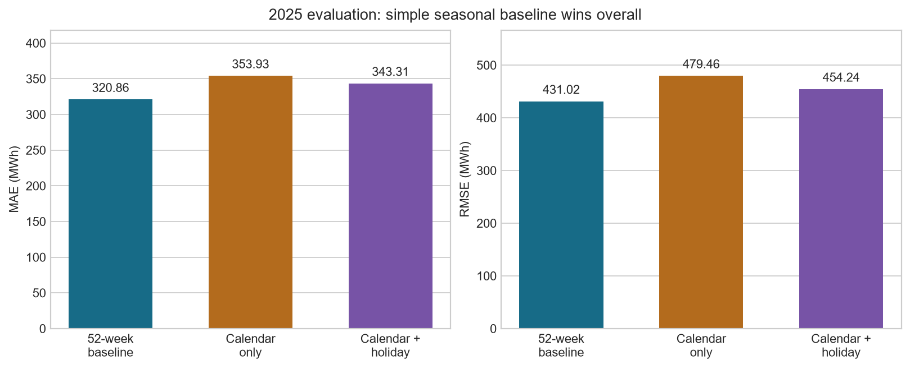
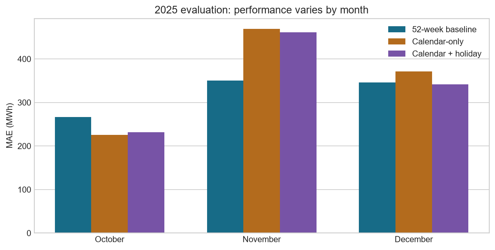
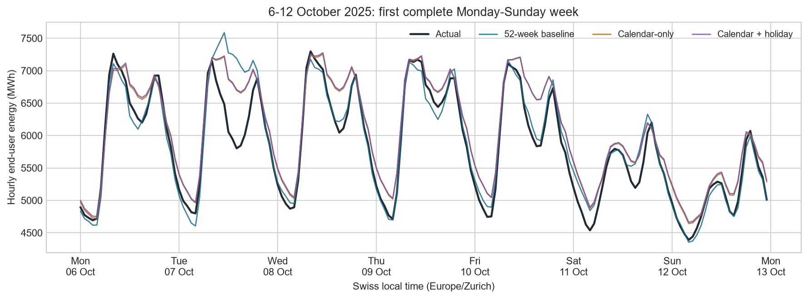

# Next-day Swiss electricity consumption forecasting

Can a fitted calendar model outperform a simple seasonal baseline when both use historical observations assumed available at forecast issue time? On the predefined October-December 2025 comparison, **the 52-week baseline performed best overall**. Adding holidays improved the fitted model, but did not make it the strongest method.

## Task and data

Forecast hourly end-user electricity consumption in the Swiss control block in MWh, issuing all of the next local day's forecasts at noon on the preceding day. A target day can contain 23, 24, or 25 hours.

The project uses Swissgrid quarter-hour workbooks for 2022-2025. Preparation handles Swiss local timestamps and daylight saving, converts to a unique UTC timeline, sums complete quarter-hours, and checks continuity and energy preservation. The exact source bytes are recorded with SHA-256 hashes. See the [data contract](../docs/data_assumptions.md) for units, timestamp evidence, and limitations.

## Evaluation design

October-December 2024 was repeatedly inspected and used to develop the holiday feature. It is development data. The later October-December 2025 comparison was defined before inspecting its outcomes and uses the same seasonal window. Each quarter contains 2,209 hours over 92 local days, including a 25-hour autumn day.

For 2025, the two fitted models use the same 27,719 eligible historical hours starting in 2022. Both are fitted once before the first issue time, September 30, 2025 at noon Swiss time, and retain fixed coefficients throughout the quarter.

Observations are admitted under an assumed maturity policy based on hourly interval ends. Historical release vintages were not reconstructed. Comparisons are retrospective under this policy, rather than verified live-service results. Previous-week and recent-level-adjusted experiments depend on recent observations unavailable through this source and remain hindsight benchmarks; their scores are not mixed into this ranking.

## Methods

| Method | Definition | Main limitation |
| --- | --- | --- |
| 52-week baseline | Copy energy 364 elapsed days earlier | Can mismatch fixed-date holidays and local clock hours |
| Calendar-only | Ordinary least squares: 168 local weekday/hour indicators plus annual sine/cosine | Restrictive seasonal shape; no weather or recent-load inputs |
| Calendar + holiday | Same features plus one shared indicator for January 1 and December 25-26 | Sparse holiday examples; no separate holiday hourly shapes |

All three methods predict the same hours. MAE is the primary metric; RMSE highlights larger misses. Mean error is prediction minus actual and describes direction of bias. A small mean error can hide large offsetting mistakes.

## Results

| Method | MAE (MWh) | RMSE (MWh) | Mean error (MWh) |
| --- | ---: | ---: | ---: |
| **52-week baseline** | **320.86** | **431.02** | -42.75 |
| Calendar-only | 353.93 | 479.46 | -53.16 |
| Calendar + holiday | 343.31 | 454.24 | -55.94 |

The holiday feature reduced calendar-only MAE by **3.00%**, mainly on December 25-26: marked-date MAE fell from 988.12 to 541.05 MWh. It still overshot on average, changing marked-date mean error from +988.12 to -303.27 MWh. The baseline remained better on those dates, at 383.30 MWh MAE.

Performance also varied by month. October favored calendar-only, November strongly favored the baseline, and December narrowly favored the holiday model. These descriptive findings do not justify selecting a different method for each month using this same evaluation quarter.

The following plot shows the first complete Monday-Sunday week in the quarter, October 6-12. This calendar rule avoids selecting a week because its errors look especially good or bad. The plot is descriptive and cannot replace the full-quarter comparison.

## What the development results taught us

With expanded history, the 2024 calendar-only and holiday models achieved MAEs of 366.64 and 359.12 MWh, respectively, versus 407.67 MWh for the baseline. Their advantage did not carry over to the overall 2025 ranking. This is why chronological evaluation matters.

The baseline retains detailed historical daily profiles; the fitted model compresses patterns into a weekly profile and a smooth annual cycle. That is a plausible explanation for some differences, not a demonstrated cause. Weather and other drivers were not measured. The evidence supports a baseline win in the evaluated quarter, not a claim that this method always wins.

## Limitations and decision

- The pre-2025 interval-end convention is supported by source endpoints but remains an assumption.
- Downloaded data can differ from historical release versions; the maturity rule does not eliminate revision uncertainty.
- One autumn/Christmas quarter does not establish year-round generalization, January 1 accuracy, or statistical significance.
- The holiday definition is deliberately limited and does not cover Swiss regional calendars.
- Both periods have now been inspected. Further model changes motivated by these findings require another untouched period for independent assessment.

Retain the **52-week baseline as the strongest overall method in this evaluation** and keep the holiday model as a research candidate. A production next-day service would require documented timely inputs and a prospective evaluation. Deployment is outside this portfolio scope.

## Reproduce and inspect

Follow the [reproduction guide](../docs/reproduction.md). The runner checks all four workbook hashes, executes the experiment in a fresh kernel, verifies all eight overall model rows against the pre-refactoring reference, and exports CSV tables, forecasts, figures, and provenance.

The [overall metrics](metrics_2025.csv), [monthly metrics](monthly_metrics_2025.csv), [holiday subsets](subset_metrics_2025.csv), and [development comparison](development_metrics_2024.csv) contain unrounded values. [Run metadata](run_metadata.json) records input hashes, source hashes, package versions, and artifact hashes. These regression checks preserve established results; they do not add new evaluation evidence.
